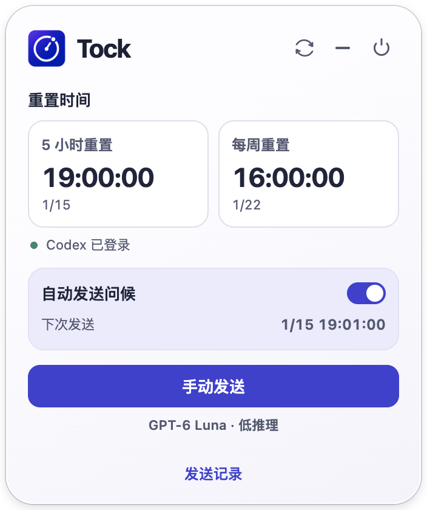

# Tock

Tock 是一个轻量的桌面浮窗，用来查看 Codex 的 5 小时和每周额度重置时间。展开就能看到时间，收起后只在屏幕边缘留一个可拖动的胶囊按钮。

[Tock 官方页面](https://makatool.com/blog/tock/)



## 下载与安装

前往 [GitHub Releases](https://github.com/xiaobc1234/tock/releases/latest)，按电脑的系统和处理器下载对应的 ZIP。

| 平台                        | v0.3.3 下载文件            | 使用方式                       |
| --------------------------- | -------------------------- | ------------------------------ |
| Mac · Apple 芯片（M 系列）  | `Tock-0.3.3-mac-arm64.zip` | 解压后将 Tock 拖入「应用程序」 |
| Mac · Intel 芯片            | `Tock-0.3.3-mac-x64.zip`   | 解压后将 Tock 拖入「应用程序」 |
| Windows · Intel / AMD 64 位 | `Tock-0.3.3-win-x64.zip`   | 解压后运行 `Tock.exe`          |

- **Mac** 需要 macOS 13 Ventura 或更新版本。在「 → 关于本机」查看芯片或处理器。
- **Windows** 需要 Windows 10 或 11 和 WebView2 Runtime。[微软官方下载](https://developer.microsoft.com/en-us/microsoft-edge/webview2/#download)
- **Codex** 需要使用 ChatGPT 账号登录本机 Codex CLI。Mac 上也支持查找 ChatGPT 桌面版自带的 CLI。[Codex CLI 安装指南](https://learn.chatgpt.com/docs/codex/cli)

Tock 使用系统 WebView，三个 ZIP 均小于 8 MB，解压后均小于 19 MB。macOS 包目前未经 Apple 公证，Windows 程序目前未签名。

## 功能特性

- **查看重置时间。** 按电脑的本地时区显示 5 小时和每周重置时间。账号只提供周额度时，面板只显示周卡片。
- **到点发送问候。** 可选在重置后 1 分钟复查，确认需要开启新周期时发送一条问候。等待期间无需定时轮询额度。
- **查看发送记录。** 面板显示所用模型、推理等级和下次自动发送时间。记录保留最近 50 次尝试，包括发送方式和结果。
- **贴边浮窗。** 面板和收起后的胶囊都可拖拽吸附到屏幕四边。胶囊动画遵循系统的减少动态效果设置。
- **中英文切换。** 默认简体中文，可从面板右上角或系统托盘的语言菜单切换为 English，选择会自动保存。

## 使用指南

1. **打开面板。** Tock 会读取本机 Codex 登录状态。首次使用时，可点击「登录 ChatGPT」在浏览器完成登录。
2. **换号后刷新。** 在 Codex 切换账号后，点击 Tock 右上角的刷新图标。Tock 会读取新账号的时间。若用量为 0%、剩余时间达到对应窗口的完整时长且有可用订阅额度，刷新可发送一次问候来开启新周期。下一次定时检查也会识别账号变化并按新时间排程。
3. **发送问候。** 可以点击「手动发送」，或打开默认关闭的「自动发送问候」。Tock 自身没有发送冷却或每日次数上限。问候会消耗可用的 Codex 订阅额度。额度不足、无法确认额度或可能使用付费 credits 时暂停发送。
4. **收起或退出。** 点减号收起，点击屏幕边缘的胶囊展开。自动发送需要 Tock 在后台运行，可在系统托盘或菜单栏开启登录系统时启动。点电源图标退出。

## 构建指南

在 Mac 上安装 Go 1.26.2 或更新版本，以及 Xcode 命令行工具，即可测试并构建三个版本。

```sh
./scripts/package-native.sh test
./scripts/package-native.sh all
```

版本号读取自 `VERSION`。三个 ZIP 会写入 `dist/release-版本号/`。单独构建可将 `all` 换成 `darwin-arm64`、`darwin-x64` 或 `win32-x64`。脚本会检查应用解压后小于 100 MB。

也可在 GitHub 仓库打开 **Actions → Build desktop packages → Run workflow**。完成后，在该运行的 **Artifacts** 下载三个可直接上传到 Release 的 ZIP。[构建工作流](.github/workflows/build.yml)

## 数据与许可

Tock 通过本机 Codex App Server 查询额度和发送问候。邮箱用于在当前面板显示，设置和发送记录保存在本机，登录凭据由 Codex 管理。Tock 无自建遥测服务。[Codex App Server 文档](https://learn.chatgpt.com/docs/app-server)

Tock 采用 MIT 许可证。[许可证](LICENSE)
